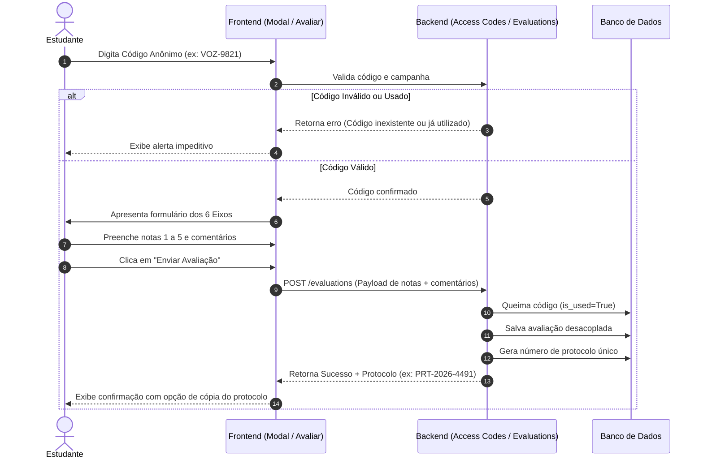

# 📋 Documento de Requisitos de Produto (PRD)

**Projeto:** Voz Escolar  
**Versão:** 1.0  
**Papel do Autor:** Analista de Sistemas  
**Status:** Aprovado para Desenvolvimento e Evolução  

---

## 1. Visão Geral e Objetivo

### 1.1 Visão Geral
O **Voz Escolar** é uma plataforma web voltada à governança escolar, ouvidoria estruturada e avaliação institucional participativa. O sistema provê um canal confidencial para que estudantes avaliem a realidade escolar com proteção total contra retaliações, viabilizada por tokens de acesso anônimos de uso único e total desacoplamento cadastral.

### 1.2 Objetivo
* **Para os Alunos:** Garantir um ambiente seguro e blindado pelo anonimato para expressar avaliações, denúncias construtivas e sugestões sobre o ambiente escolar.
* **Para a Gestão Escolar:** Fornecer indicadores quantitativos consolidados e feedbacks qualificados, permitindo criar, executar e prestar contas de **Planos de Melhoria** contínuos.
* **Para a Comunidade:** Promover transparência ativa sobre a evolução dos eixos pedagógicos e estruturais da instituição.

---

## 2. Público-Alvo

| Perfil | Descrição e Papel no Sistema |
| :--- | :--- |
| **Estudante Elegível** | Aluno regularmente matriculado. Acessa a plataforma mediante código alfanumérico anônimo para avaliar a escola e recebe número de protocolo. |
| **Gestão Escolar (Direção e Coordenação)** | Equipe gestora da unidade. Analisa diagnósticos, emite lotes de códigos físicos/digitais, responde publicamente aos feedbacks e gerencia planos de ação. |
| **Moderador Ético** | Responsável por auditar e aprovar ou reter comentários livres, assegurando que ofensas ou exposições indevidas não sejam veiculadas, preservando o direito à crítica legítima. |
| **Visitante / Comunidade Externa** | Responsáveis legais, conselhos escolares e cidadãos em geral. Consultam dados consolidados, notas médias e o andamento das melhorias planejadas. |
| **Administrador Geral** | Responsável pela homologação de novas escolas na rede, auditoria técnica e supervisão de conformidade. |

---

## 3. Escopo

### 3.1 Dentro do Escopo (In-Scope)
* **Autenticação Anônima:** Validação de tokens de uso único gerados em lote por campanha sem vínculo com dados nominais do estudante.
* **Avaliação em 6 Eixos Temáticos:** 5 eixos quantitativos (notas 1 a 5) e 1 eixo qualitativo de propostas e comentários livres.
* **Rastreabilidade Confidencial:** Emissão de protocolo aleatório para consulta do status ético da avaliação e respostas da gestão.
* **Triagem e Moderação Ética:** Mecanismo semiautomático com retenção de ofensas e dados pessoais sensíveis, apoiado por fila humana de moderação.
* **Gestão de Planos de Melhoria:** Cadastro, atualização de progresso percentual (0 a 100%) e publicação de ações com prazos e responsáveis.
* **Portal de Transparência da Escola:** Exibição pública de médias e comentários aprovados respeitando a regra de quórum mínimo.
* **Geração de Lotes de Códigos:** Emissão e exportação de tokens anônimos para distribuição pela escola.

### 3.2 Fora do Escopo (Out-of-Scope)
* Gestão acadêmica formal (lançamento de notas bimestrais, faltas, diário de classe ou boletins).
* Mensageria direta ou chat síncrono aberto entre alunos e professores.
* Rastreamento de dados telemétricos (IP, geolocalização ou *fingerprinting*) com finalidade de identificação do aluno avaliador.
* Processamento financeiro (mensalidades, taxas ou doações).
* Aplicativo mobile nativo (o projeto prioriza Web responsivo - PWA/Mobile Web).

---

## 4. Requisitos Funcionais (RF)

| ID | Nome do Requisito | Descrição |
| :--- | :--- | :--- |
| **RF01** | Validação de Código Anônimo | O sistema deve validar o código alfanumérico de acesso, autorizando a avaliação apenas se o código estiver ativo, não utilizado e pertencer a uma campanha vigente. |
| **RF02** | Queima de Código Único | Ao submeter com sucesso a avaliação, o sistema deve marcar o código como utilizado (`is_used = True`) de forma atômica e irreversível, impedindo reaproveitamento. |
| **RF03** | Avaliação Quantitativa dos 5 Eixos | O sistema deve coletar notas obrigatórias de 1 a 5 para: Ensino, Infraestrutura, Higiene, Alimentação e Convivência. |
| **RF04** | Registro de Comentários e Sugestões | O sistema deve permitir o envio de comentários qualitativos opcionais por eixo e um campo geral para propostas e sugestões discentes. |
| **RF05** | Cálculo Automático de Médias | O sistema deve calcular automaticamente a média aritmética geral da avaliação e atualizar os consolidados por campanha e por escola. |
| **RF06** | Emissão de Protocolo Confidencial | Ao finalizar a submissão, o sistema deve gerar e exibir um código de protocolo único e aleatório (ex: `PRT-XXXX-XXXX`), permitindo ao aluno copiar ou imprimir. |
| **RF07** | Consulta de Protocolo | O sistema deve permitir que o portador do protocolo consulte o andamento de sua submissão, status de moderação e eventuais respostas da escola. |
| **RF08** | Fila de Moderação Ética | Comentários enviados devem ser triados. Caso contenham palavras sensíveis, devem ser marcados como pendentes (`PENDING` ou `FLAGGED`) para análise manual. |
| **RF09** | Ação do Moderador | O moderador credenciado pode aprovar (`APPROVED`) ou reter (`REJECTED`) o comentário, registrando justificativa ética no log de auditoria. |
| **RF10** | Emissão de Lotes de Códigos | A direção deve poder gerar lotes de códigos anônimos informando a quantidade e o agrupamento físico (ex: "3º Ano A"), sem qualquer vínculo nominal de alunos. |
| **RF11** | Painel Analítico da Gestão | O sistema deve fornecer à direção um dashboard com volume de participantes, médias por eixo, comentários moderados e gráficos comparativos. |
| **RF12** | Resposta Oficial aos Feedbacks | A equipe de gestão deve ter a funcionalidade de emitir uma resposta oficial pública a qualquer comentário discente aprovado. |
| **RF13** | Cadastro e Gestão de Planos de Ação | A escola deve poder cadastrar Planos de Melhoria contendo título, descrição, eixo correspondente, setor responsável, prazo estimado e status (`PLANNED`, `IN_PROGRESS`, `COMPLETED`, `CANCELLED`). |
| **RF14** | Acompanhamento de Progresso (%) | A gestão deve poder atualizar o percentual de execução (0% a 100%) dos planos cadastrados. |
| **RF15** | Página Pública da Escola | O sistema deve disponibilizar uma página pública acessível a qualquer cidadão, exibindo notas consolidadas, comentários públicos moderados e planos de ação. |
| **RF16** | Proteção por Quórum Mínimo | A página pública deve ocultar médias e feedbacks caso a campanha não atinja o número mínimo de respostas parametrizado (padrão: 10 avaliações). |
| **RF17** | Gestão de Campanhas Letivas | A gestão/administração deve ser capaz de criar e fechar campanhas periódicas de avaliação (ex: "2026.1"), vinculando datas de início e término. |

---

## 5. Requisitos Não Funcionais (RNF)

### 5.1 Desempenho
* **RNF01 (Tempo de Resposta):** O tempo de carregamento de páginas estáticas e requisições de consulta pública deve ser inferior a 1,5 segundos em conexões padrão 4G/Banda Larga.
* **RNF02 (Concorrência de Pico):** A arquitetura do backend deve suportar no mínimo 500 submissões simultâneas de avaliação, prevendo aplicação síncrona em salas de informática escolares.
* **RNF03 (Escalabilidade de Banco):** Consultas de consolidação e médias agregadas devem utilizar índices adequados e cache para mitigar sobrecarga no banco de dados relacional.

### 5.2 Segurança
* **RNF04 (Entropia Criptográfica):** Os códigos de acesso anônimos e números de protocolo devem ser gerados através de geradores pseudoaleatórios criptograficamente seguros (CSPRNG), impedindo previsibilidade ou força bruta.
* **RNF05 (Proteção de Endpoints):** O sistema deve conter defesas ativas contra ataques de injeção de SQL, Cross-Site Scripting (XSS) e Cross-Site Request Forgery (CSRF).
* **RNF06 (Controle de Acesso RBAC):** Autenticação robusta para gestores e moderadores via senhas hasheadas (PBKDF2/Argon2) e isolamento rigoroso entre escolas (um gestor da Escola A não pode ver dados não públicos da Escola B).

### 5.3 Usabilidade
* **RNF07 (Responsividade Mobile-First):** O layout deve se adaptar com fidelidade a dispositivos móveis (smartphones), tablets e computadores desktop.
* **RNF08 (Acessibilidade Digital):** A interface deve seguir as diretrizes da WCAG 2.1 nível AA, garantindo contraste de cores, suporte a navegação por teclado e semântica HTML adequada para leitores de tela.
* **RNF09 (Clareza do Fluxo):** O processo de preenchimento da avaliação deve ser intuitivo, com divisão clara dos 6 eixos e mensagens de erro explícitas e orientativas.

### 5.4 LGPD e Privacidade por Design
* **RNF10 (Desacoplamento e Não Rastreabilidade):** Nenhuma chave estrangeira, identificador de matrícula, nome ou documento do estudante pode ser salvo na tabela de avaliações.
* **RNF11 (Minimização de Dados):** O sistema não deve exigir dados cadastrais nem coletar dados pessoais para a execução do direito de escuta.
* **RNF12 (Proteção contra Inferência):** A exigência de quórum mínimo obrigatório impede que respostas isoladas permitam a identificação do autor em turmas pequenas.
* **RNF13 (Anonimização de Logs de Acesso):** Logs de servidor e infraestrutura não devem correlacionar o endereço IP do usuário ao número de protocolo ou às respostas enviadas.

---

## 6. Regras de Negócio (RN)

* **RN01 - Unicidade e Invalidação do Código:** Cada código anônimo só pode ser utilizado uma única vez. Ao ser validado no formulário e enviado, seu status transiciona para `is_used = True` e a data de uso é registrada.
* **RN02 - Vigência da Campanha:** Avaliações só são aceitas se a data corrente estiver contida no intervalo `start_date` e `end_date` da campanha, e seu status for ativo (`is_active = True`).
* **RN03 - Completude Quantitativa:** É obrigatório atribuir nota (valor inteiro de 1 a 5) em todos os 5 eixos quantitativos. Avaliações parciais não são processadas.
* **RN04 - Trava de Quórum para Publicidade:** As notas médias e os comentários de uma escola/campanha só se tornam visíveis ao público geral após o atingimento do quórum mínimo (`min_quorum`, padrão: 10 respostas). Antes disso, exibe-se a mensagem: *"Aguardando quórum mínimo de segurança para divulgação"*.
* **RN05 - Moderação Ética e Filtragem de Injúria:** Críticas duras a métodos pedagógicos ou estrutura são preservadas. No entanto, comentários contendo calúnia, injúria dirigida a indivíduos nominados, termos discriminatórios ou vazamento de dados de terceiros (nomes completos, telefones) são sumariamente retidos com status `REJECTED`.
* **RN06 - Imutabilidade da Resposta Discente:** Uma vez submetida a avaliação e gerado o protocolo, as notas e textos não podem ser editados nem pela escola, nem pelo próprio aluno (garantia de integridade amostral).
* **RN07 - Unicidade de Resposta Oficial da Gestão:** Cada comentário aprovado pode receber apenas 1 (uma) resposta oficial da gestão daquela unidade escolar, podendo ser editada pelo gestor responsável.
* **RN08 - Distribuição Cega de Códigos:** Os lotes de códigos gerados não podem ser associados a números de chamada ou CPFs no momento da entrega; a entrega deve ser aleatória aos alunos da turma.

---

## 7. Fluxos Principais

### 7.1 Fluxo 1: Participação e Avaliação do Estudante


### 7.2 Fluxo 2: Moderação Ética de Comentários
1. **Entrada:** Avaliação persistida contendo comentários textuais.
2. **Triagem Automática:** Filtro léxico checa termos ofensivos e dados sensíveis (CPF, nomes).
   * Se limpo: status inicial `PENDING` ou `AUTO_APPROVED` (conforme configuração da rede).
   * Se houver gatilho: status `FLAGGED` (sinalizado para moderação imediata).
3. **Ação do Moderador:** Na fila de moderação, o analista ético avalia o contexto:
   * **Aprovar:** Comentário vai para o banco de exibição pública.
   * **Rejeitar:** Comentário é retido; moderador registra o motivo ético (ex: "Ofensa pessoal").
4. **Histórico:** A ação gera um registro no log de moderação com data e autor.

### 7.3 Fluxo 3: Ciclo de Gestão e Governança
1. **Diagnóstico:** Gestor acessa o Painel da Escola e identifica eixos críticos (ex: *Higiene: 2.1*).
2. **Interação Pública:** Gestor responde ao feedback dos alunos com um posicionamento formal da escola.
3. **Criação do Plano de Ação:** Gestor cadastra uma nova iniciativa (ex: *"Reforma hidráulica dos sanitários do bloco B"*, prazo: 60 dias, setor responsável: Infraestrutura).
4. **Execução e Acompanhamento:** Ao longo do semestre, a gestão atualiza o percentual de progresso (ex: 50% -> 100%), prestando contas à comunidade escolar.

### 7.4 Fluxo 4: Acompanhamento por Protocolo
1. Estudante acessa a página pública de Consulta de Protocolo.
2. Digita seu código de protocolo (ex: `PRT-2026-7812`).
3. Sistema localiza o protocolo e exibe a linha do tempo confidencial:
   * *Status 1:* Avaliação Recebida
   * *Status 2:* Análise Ética (Pendente / Aprovado / Retido)
   * *Status 3:* Resposta da Direção (caso exista)

---

## 8. Critérios de Aceitação

### CA01 - Submissão bem-sucedida de avaliação com código válido
* **Dado** que o estudante possui um código de acesso ativo e não utilizado para a campanha vigente,
* **Quando** ele preencher todos os 5 eixos quantitativos com notas de 1 a 5 e submeter o formulário,
* **Então** o sistema deve persistir a avaliação, invalidar o código para novos acessos, gerar um número de protocolo único e exibir a mensagem de sucesso na tela.

### CA02 - Bloqueio de reutilização de código
* **Dado** que um código de acesso já tenha sido utilizado anteriormente (`is_used = True`),
* **Quando** um usuário tentar autenticar no modal com esse mesmo código,
* **Então** o sistema deve negar a entrada, mantendo o formulário bloqueado e exibindo: *"Este código já foi utilizado para envio de avaliação nesta campanha."*

### CA03 - Proteção de privacidade por quórum mínimo
* **Dado** que uma escola possui apenas 6 avaliações registradas e seu quórum mínimo configurado é 10,
* **Quando** qualquer visitante acessar a página pública da instituição,
* **Então** as notas médias e os comentários não devem ser calculados nem exibidos, apresentando em seu lugar o aviso informativo de quórum em andamento.

### CA04 - Retenção ética de ofensas e dados pessoais
* **Dado** que um estudante submeteu um comentário contendo nomes de funcionários ou termos difamatórios,
* **Quando** o filtro ou o moderador ético analisar o texto e marcá-lo como `REJECTED`,
* **Então** o texto não deve aparecer na página pública da escola, e a consulta via protocolo deve informar ao estudante que o comentário foi retido de acordo com as Diretrizes Éticas da Comunidade.

### CA05 - Cadastro e publicação de plano de melhoria
* **Dado** que o gestor escolar está autenticado em sua conta institucional,
* **Quando** ele cadastrar um novo Plano de Ação informando título, eixo, descrição, responsável e prazo, marcando a opção "Público",
* **Então** o plano deve ser listado imediatamente no painel interno e na aba de melhorias da página pública da escola.

---

## 9. Priorização (MVP) e Matriz de Riscos

### 9.1 Matriz de Priorização (MoSCoW)

```
+---------------------------------------------------------------------------------------+
|  MUST HAVE (Essencial para o MVP)                                                     |
|  - Geração e validação de lotes de códigos anônimos (RF01, RF02, RF10)                |
|  - Formulário completo dos 6 eixos de avaliação (RF03, RF04, RF05)                    |
|  - Emissão e consulta de protocolo aleatório (RF06, RF07)                             |
|  - Regra de quórum mínimo de segurança (RF16)                                         |
|  - Painel básico da gestão com médias agregadas (RF11)                                |
+---------------------------------------------------------------------------------------+
|  SHOULD HAVE (Importante para a V1.1)                                                 |
|  - Moderação ética semiautomática com logs de auditoria (RF08, RF09)                  |
|  - Módulo completo de Planos de Melhoria com régua de progresso (RF13, RF14)          |
|  - Resposta oficial da gestão aos comentários moderados (RF12)                        |
|  - Página pública da escola com visualização gráfica (RF15)                           |
+---------------------------------------------------------------------------------------+
|  COULD HAVE (Desejável para V2.0)                                                     |
|  - Exportação de relatórios executivos em PDF/Excel para conselhos escolares           |
|  - Módulo de Inteligência Artificial para análise de sentimento dos comentários       |
|  - Notificação de progresso da campanha para murais digitais                          |
+---------------------------------------------------------------------------------------+
|  WON'T HAVE (Fora de cogitação nesta fase)                                            |
|  - App mobile nativo para iOS/Android                                                 |
|  - Integração com sistemas de chamada e faltas de alunos                              |
+---------------------------------------------------------------------------------------+
```

### 9.2 Matriz de Riscos e Planos de Mitigação

| Risco Identificado | Impacto | Probabilidade | Plano de Mitigação |
| :--- | :---: | :---: | :--- |
| **R01 - Desconfiança dos alunos sobre o anonimato** | Alto | Alta | Comunicação clara e didática no modal inicial explicando o desacoplamento de dados; entrega física aleatória de tíquetes com códigos sem anotação nominal. |
| **R02 - Uso indevido para difamação ou cyberbullying** | Alto | Média | Duplo estágio de moderação ética (filtro heurístico léxico + revisão humana) antes da publicação na página externa. |
| **R03 - Omissão da gestão em responder e criar planos** | Médio | Média | O portal público evidencia quando a escola não possui planos cadastrados, incentivando a liderança a manter a governança ativa perante a comunidade. |
| **R04 - Sobrecarga de envios síncronos em laboratório** | Médio | Média | Otimização das queries de escrita, transações rápidas para queima de código e desacoplamento do cálculo de agregação pesada em rotinas assíncronas. |
| **R05 - Reidentificação em turmas muito reduzidas** | Alto | Baixa | Imposição rígida da trava de quórum mínimo configurada por campanha e proibição de cruzamentos demográficos hipersegmentados. |
